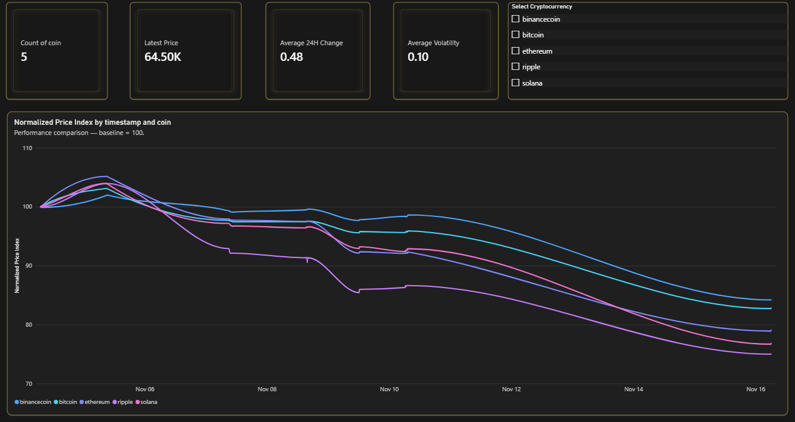
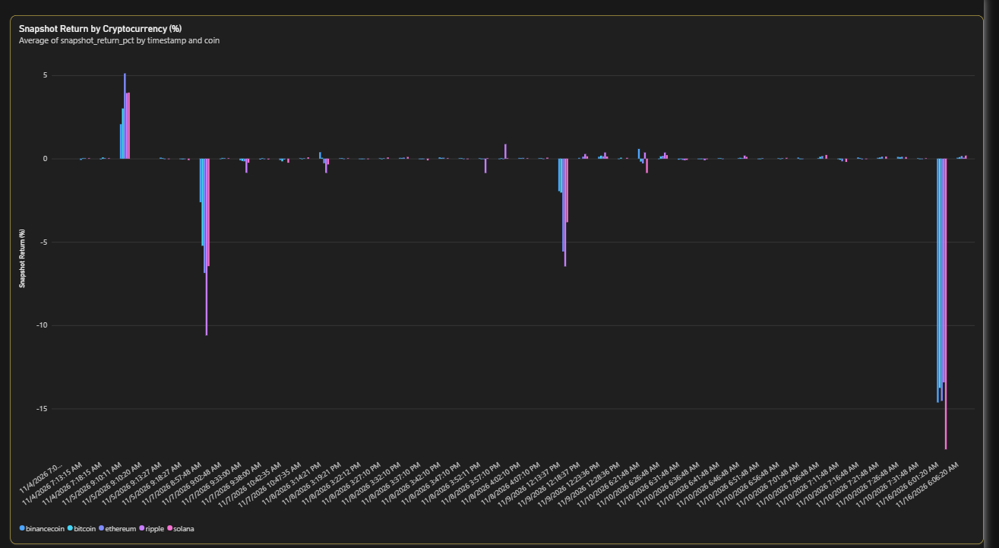
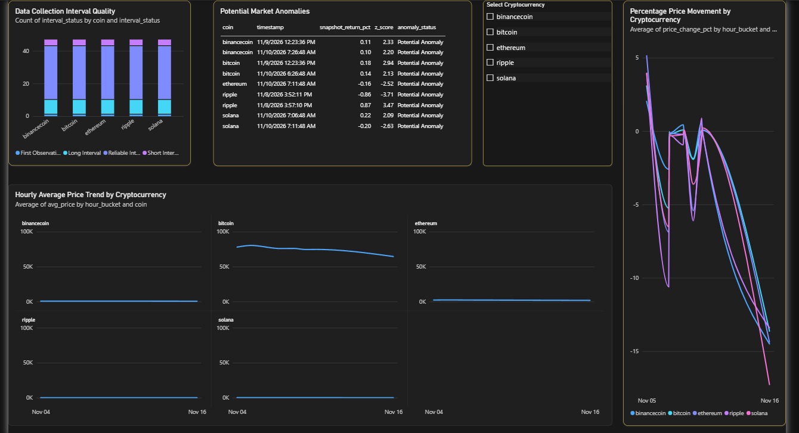

# Real-Time Crypto Market Analytics

An end-to-end data analytics project that collects cryptocurrency market data from the CoinGecko API, validates and stores historical price observations in Microsoft SQL Server, analyzes market movement and data-collection quality with SQL, and presents the results in an interactive Power BI dashboard.

The project demonstrates a practical analytics workflow across **Python, SQL Server, SQL, Power BI, and GitHub** — from API extraction through data preparation and storage to analysis and visual storytelling.

> **Project scope:** This is a near-real-time polling and analytics pipeline. It is not a tick-level exchange feed or a continuously streaming market-data platform.

---

## Table of contents

- [Business problem](#business-problem)
- [Project objectives](#project-objectives)
- [Cryptocurrencies covered](#cryptocurrencies-covered)
- [Technology stack](#technology-stack)
- [End-to-end workflow](#end-to-end-workflow)
- [Repository structure](#repository-structure)
- [Data collection and preparation](#data-collection-and-preparation)
- [Database design](#database-design)
- [SQL analysis](#sql-analysis)
- [Power BI dashboard](#power-bi-dashboard)
- [Key analytical definitions](#key-analytical-definitions)
- [How to run the project](#how-to-run-the-project)
- [Validation and testing](#validation-and-testing)
- [Limitations and future improvements](#limitations-and-future-improvements)
- [Project files](#project-files)

---

## Business problem

Cryptocurrency prices can change rapidly, but raw API responses alone do not provide a useful view of market behaviour or the reliability of a data-collection process.

This project addresses two related questions:

1. **Market analysis:** How have the selected cryptocurrencies moved across the observations collected by the pipeline, and how do their price trends and volatility compare?
2. **Data reliability:** Is the collection process recording observations at the intended intervals, and where are there short or long gaps in the collected history?

The dashboard brings these perspectives together so that market analysis can be interpreted alongside the quality and coverage of the underlying data.

## Project objectives

- Collect USD prices and API-reported 24-hour percentage changes for five cryptocurrencies.
- Build a reusable Python extraction process with timeouts, retries, and response validation.
- Clean and validate incoming records before database insertion.
- Store timestamped historical observations in SQL Server.
- Use SQL window functions and aggregations to calculate returns, moving averages, volatility, hourly summaries, and collection intervals.
- Build a Power BI report that communicates market movement and collection quality.
- Document the workflow, analytical assumptions, and limitations so that the project can be reproduced and reviewed.

## Cryptocurrencies covered

The pipeline requests the following CoinGecko asset IDs:

| Cryptocurrency | CoinGecko ID |
|---|---|
| Bitcoin | `bitcoin` |
| Ethereum | `ethereum` |
| BNB | `binancecoin` |
| Solana | `solana` |
| XRP | `ripple` |

The API endpoint used is CoinGecko's [Simple Price API](https://docs.coingecko.com/reference/simple-price), with USD prices and the API's 24-hour change field requested.

## Technology stack

| Tool / technology | Role in the project |
|---|---|
| Python 3.11 | Pipeline logic and data preparation |
| Requests | HTTP requests to CoinGecko |
| pandas | Tabular data handling and cleaning |
| NumPy | Synthetic test-data generation |
| SQLAlchemy | Python-to-SQL Server database connection |
| pyodbc / ODBC Driver 18 | SQL Server connectivity |
| Microsoft SQL Server Express | Historical data storage and SQL analysis |
| SQL Server Management Studio (SSMS) | Database and query development |
| Power BI Desktop | Interactive dashboard and visual analysis |
| Git and GitHub | Version control and project documentation |

## End-to-end workflow

```text
CoinGecko Simple Price API
          |
          v
     Python fetch.py
  (request, retry, validate)
          |
          v
   clean_data.py / pandas
 (standardize, validate, deduplicate)
          |
          v
    SQL Server Express
  CryptoAnalyticsDB
  dbo.CryptoPriceHistory
          |
          v
       SQL analysis
 (snapshot, interval, hourly views)
          |
          v
      Power BI Desktop
 (market and data-quality report)
```

### 1. Extract

Python sends a request to CoinGecko for the five selected assets. The response includes the USD price and, when available, the API-reported 24-hour percentage change. A UTC timestamp is attached to each successful collection.

### 2. Validate and clean

The incoming DataFrame is standardized before it is saved:

- Cryptocurrency IDs are stripped of surrounding whitespace and converted to lowercase.
- Price and 24-hour change fields are converted to numeric values.
- Timestamps are parsed and normalized to UTC.
- Rows missing an essential coin ID, price, or timestamp are removed.
- Empty coin IDs and zero or negative prices are removed.
- Duplicate observations for the same coin and timestamp are removed, keeping the last occurrence.
- A missing API 24-hour change is allowed because it is an optional field; it does not automatically invalidate an otherwise usable price observation.

### 3. Store

Cleaned observations are appended to SQL Server in the `CryptoAnalyticsDB` database. The pipeline checks that the intended destination table exists before inserting data, so it does not silently create a replacement table.

### 4. Analyze

SQL queries and views prepare the data for analysis. They cover latest observations, consecutive-snapshot returns, moving averages, historical high and low prices, return volatility, interval quality, and hourly price movement.

### 5. Visualize

Power BI connects to the SQL Server data and analytical views. The report is organized into three pages: Market Overview, Market Performance, and Data Quality.

---

## Repository structure

```text
realtime-crypto-analytics/
├── crypto_dashboard_pngs/
│   ├── market-overview.png
│   ├── market-performance.png
│   └── data-quality.png
├── sql/
│   ├── 01_crypto_analytics.sql
│   ├── 02_hourly_analysis.sql
│   ├── 03_interval_quality.sql
│   └── crypto_analysis.sql
├── clean_data.py
├── fetch.py
├── db_connection.py
├── save_to_database.py
├── pipeline.py
├── test_environment.py
├── requirements.txt
├── .env.example
├── .gitignore
├── Crypto_Market_Analytics.pbix
└── README.md
```

### Main Python files

| File | Responsibility |
|---|---|
| `fetch.py` | Calls CoinGecko, retries temporary failures, validates the response, and returns a DataFrame |
| `clean_data.py` | Cleans and validates the extracted records; includes synthetic-data and edge-case tests |
| `db_connection.py` | Creates the SQLAlchemy connection to SQL Server |
| `save_to_database.py` | Fetches, cleans, and appends a snapshot to the SQL table |
| `pipeline.py` | Coordinates extraction, cleaning, insertion, logging, and cycle summaries |
| `test_environment.py` | Checks the local Python environment and required packages |
| `requirements.txt` | Lists Python dependencies |

The `crypto_dashboard_pngs/` directory contains the dashboard screenshots used in this README. The Power BI report file is included in the repository as `Crypto_Market_Analytics.pbix`.

---

## Data collection and preparation

### API request behaviour

The extraction module uses:

- A request timeout of 15 seconds.
- Up to three attempts for retryable failures.
- Exponential backoff between retry attempts.
- Immediate termination for permanent client-side HTTP errors, rather than repeatedly retrying them.
- Validation of the response structure and individual coin records.
- Handling for empty responses, missing USD prices, malformed entries, and non-numeric values.

The 24-hour change returned by CoinGecko is stored separately from returns calculated later using the project's own collected snapshots.

### Data cleaning rules

| Check | Treatment |
|---|---|
| Coin ID formatting | Trim whitespace and convert to lowercase |
| Price / change data types | Convert to numeric; invalid values become missing |
| Timestamp | Parse and normalize to UTC |
| Missing coin, price, or timestamp | Remove the row |
| Empty coin ID | Remove the row |
| Zero or negative price | Remove the row |
| Duplicate coin + timestamp | Keep the last occurrence |
| Missing API 24-hour change | Retain the row if essential fields are valid |

### Time handling

Collection timestamps are created in UTC. The pipeline converts timezone-aware UTC timestamps to UTC-naive values before writing to SQL Server because the destination column uses `DATETIME2`, which does not store timezone metadata. The values therefore represent UTC even though the SQL column itself is timezone-naive.

---

## Database design

**Database:** `CryptoAnalyticsDB`  
**Source table:** `dbo.CryptoPriceHistory`

| Column | Type / behaviour | Description |
|---|---|---|
| `id` | `BIGINT IDENTITY`, primary key | Unique row identifier |
| `coin` | `VARCHAR(50)`, not null | CoinGecko asset ID |
| `price` | `DECIMAL(18,8)`, not null | USD price at collection time |
| `chg_24h` | `DECIMAL(12,6)`, nullable | API-reported 24-hour percentage change |
| `timestamp` | `DATETIME2(3)`, UTC value | Time the Python process collected the observation |
| `created_at` | `DATETIME2(3)`, UTC default | Time SQL Server inserted the row |

### Analytical views

| View | Purpose |
|---|---|
| `dbo.vw_CryptoAnalytics` | Snapshot-level market calculations and collection interval fields used by the report |
| `dbo.vw_CryptoIntervalQuality` | Classifies the time between consecutive observations for each cryptocurrency |
| `dbo.vw_CryptoHourlyAnalysis` | Aggregates observations into hourly buckets and calculates movement from the previous available bucket |

The three numbered SQL files contain reproducible `CREATE OR ALTER VIEW` definitions for all analytical views. They use the same reliable collection interval of 240–360 seconds.

---

## SQL analysis

The SQL work uses common analytical techniques that are useful in data analyst and business analyst workflows.

### Snapshot-level analysis

- **Latest observation:** A common table expression (CTE) and `ROW_NUMBER()` identify the latest stored observation for each coin.
- **Snapshot return:** `LAG()` retrieves the previous collected price, allowing the percentage movement between consecutive observations to be calculated.
- **Moving averages:** Windowed `AVG()` calculations produce 5-observation and 10-observation moving averages.
- **Historical range:** `MAX()` and `MIN()` calculate the highest and lowest recorded prices per cryptocurrency.
- **Ranking:** `RANK()` compares the latest API-reported 24-hour changes across the selected assets.
- **Return volatility:** `AVG()` and SQL Server's `STDEV()` summarize calculated snapshot returns.

### Collection interval analysis

For each cryptocurrency, the analysis compares a collection timestamp with the previous available timestamp. The elapsed time is used to classify the observation interval:

- `First Observation` — no earlier observation exists for that coin.
- `Reliable Interval` — the elapsed time falls within the project's configured reliable interval range.
- `Short Interval` — the elapsed time is shorter than the configured range.
- `Long Interval` — the elapsed time exceeds the configured range.

This makes it possible to examine whether the data is arriving at reasonably consistent intervals, rather than assuming every expected observation was collected.

### Hourly analysis

The hourly view groups records by cryptocurrency and hour. For each bucket it calculates:

- Average price.
- Number of observations.
- Previous available hourly average.
- Absolute price difference.
- Percentage price change.

The view uses `LAG()` to compare each bucket with the previous available bucket for the same coin.

### SQL scripts in this repository

Run the numbered view-creation scripts in order after creating the source table:

1. [01 — Crypto analytics](sql/01_crypto_analytics.sql) — snapshot returns, moving average, interval classification, reliable returns, volatility, Z-score, and exploratory anomaly status.
2. [02 — Hourly analysis](sql/02_hourly_analysis.sql) — hourly average prices, observation counts, previous available hourly average, and price movement.
3. [03 — Interval quality](sql/03_interval_quality.sql) — previous observation timestamps and consistent 240–360 second interval classification.

Additional analytical query examples are available in [SQL analysis practice queries](sql/crypto_analysis.sql). The older duplicate hourly view script has been removed. Use the numbered script above as the single canonical definition of `dbo.vw_CryptoHourlyAnalysis`.

The numbered scripts use `CREATE OR ALTER VIEW`, so they can create the views on a fresh database or update existing definitions. Run them against `CryptoAnalyticsDB` after `dbo.CryptoPriceHistory` exists.

---

## Power BI dashboard

The Power BI report contains three pages. Each page answers a different analytical question.

### 1. Market Overview



**What this page explains**

This page provides a high-level view of the selected cryptocurrency market. KPI cards summarize the latest values available in the model, while the price trend visual shows how recorded prices have changed over the collection period. The cryptocurrency slicer allows the report reader to focus on an individual asset or compare the selected assets.

**How to read it**

- Use the slicer to select a cryptocurrency.
- Review the KPI cards for the latest summary values.
- Use the trend chart to understand the direction and variation of the recorded price.
- Treat the view as a summary of collected observations, not as a live trading screen.

### 2. Market Performance



**What this page explains**

This page focuses on price movement and comparison. It brings together snapshot-return analysis and hourly price movement so that the reader can examine how the selected assets have moved across the observations available in the database.

**How to read it**

- Compare snapshot-return behaviour across cryptocurrencies.
- Use the hourly price trend to inspect the movement of hourly average prices.
- Review the percentage movement visual to compare changes between consecutive available hourly buckets.
- Interpret large movements in the context of the observation timestamps and the amount of data available.

### 3. Data Quality



**What this page explains**

This page examines the reliability of the collected dataset. It shows how observation intervals are classified and provides supporting detail for identifying gaps or irregular collection timing. The report also includes exploratory anomaly information from the available price history.

**How to read it**

- Review the Reliable Collection Rate as a measure of intervals classified as reliable under the project's rules.
- Compare reliable, short, and long intervals to see where collection timing differs from the target range.
- Inspect the interval detail and anomaly table for individual observations that may need investigation.
- Use the page to assess data coverage before drawing conclusions from market visuals.

### Power BI file

The Power BI Desktop report is available in the repository:

[`Crypto_Market_Analytics.pbix`](Crypto_Market_Analytics.pbix)

Open it with Power BI Desktop. The report was developed against a local SQL Server database, so another user may need to update the data source settings and configure their own SQL Server connection before refreshing.

**Refresh note:** The documented workflow uses a manual refresh in Power BI Desktop. A published Power BI Service report, configured on-premises gateway, and scheduled refresh are not claimed as part of this project.

---

## Key analytical definitions

These distinctions matter when interpreting the dashboard.

| Metric / term | Meaning in this project | What it does not mean |
|---|---|---|
| API 24-hour change (`chg_24h`) | Percentage change supplied by CoinGecko for its 24-hour period | It is not calculated from this project's two most recent rows |
| Snapshot return | Percentage movement from one collected observation to the next available observation for the same coin | It is not necessarily a 5-minute return or a 24-hour return |
| Hourly percentage movement | Percentage movement between the current hourly average and the previous available hourly average | It is not guaranteed to represent exactly one clock hour when buckets are missing |
| Reliable Collection Rate | Share of comparable intervals classified as reliable under the project's interval rules; first observations are excluded from the denominator | It is not CoinGecko uptime, API availability, or market performance |
| Volatility | Sample standard deviation of the calculated snapshot returns in the selected dataset | It is not a forecast or a complete measure of cryptocurrency risk |
| Anomaly flag | An exploratory statistical indicator based on the available observations | It is not proof of a market event, manipulation, or data error |

---

## How to run the project

### Prerequisites

- Python 3.11.
- Microsoft SQL Server Express running locally or on a reachable server.
- SQL Server Management Studio (SSMS).
- Microsoft ODBC Driver 18 for SQL Server.
- Git.
- Power BI Desktop to open and refresh the report.
- Access to the CoinGecko API endpoint.

### 1. Clone the repository

```bash
git clone https://github.com/HarshVaibhav/realtime-crypto-analytics.git
cd realtime-crypto-analytics
```

### 2. Create and activate a virtual environment

On Windows PowerShell:

```powershell
python -m venv venv
.\venv\Scripts\Activate.ps1
```

### 3. Install dependencies

```bash
python -m pip install -r requirements.txt
```

### 4. Configure SQL Server

Create a database named `CryptoAnalyticsDB` and create the `dbo.CryptoPriceHistory` table with the schema described in the [Database design](#database-design) section.

Copy the example configuration and edit your local settings:

```powershell
Copy-Item .env.example .env
```

Open `.env` and set `SQL_SERVER` to your SQL Server instance (for example, `localhost\\SQLEXPRESS`). Keep `SQL_TRUSTED_CONNECTION=yes` for Windows Authentication. If you use SQL Server Authentication, set it to `no` and provide `SQL_USERNAME` and `SQL_PASSWORD`. The connection module reads these settings from `.env`; the real `.env` file is ignored by Git. Never commit credentials.

### 5. Test the environment and API extraction

```bash
python test_environment.py
python fetch.py
```

### 6. Test data cleaning

```bash
python clean_data.py
```

The script runs synthetic-data and edge-case tests by default. The live API cleaning test is available in the file as a separate function.

### 7. Test the database connection

```bash
python db_connection.py
```

### 8. Insert one collection snapshot

```bash
python save_to_database.py
```

### 9. Run the pipeline

```bash
python pipeline.py
```

The committed pipeline configuration uses `MAX_CYCLES = 2` and `INTERVAL_SECONDS = 300`. It performs two controlled collection cycles with a five-minute interval between cycle starts. It is not configured as an always-on service.

### 10. Create or refresh the SQL analytical views

After creating `dbo.CryptoPriceHistory`, open these scripts in SSMS and run them in order against `CryptoAnalyticsDB`:

1. `sql/01_crypto_analytics.sql`
2. `sql/02_hourly_analysis.sql`
3. `sql/03_interval_quality.sql`

Each script creates or alters its view and includes a verification query. The three views use a consistent reliable interval threshold of 240–360 seconds.

### 11. Open and refresh the Power BI report

Open `Crypto_Market_Analytics.pbix` in Power BI Desktop. If the report is opened on another machine, update its SQL Server data source settings, ensure the analytical views are available, and perform a manual refresh.

---

## Validation and testing

The following checks were recorded during local project development:

- CoinGecko extraction was tested for five assets.
- Request timeout, retry handling, empty-response handling, and malformed or partial API data were considered in the extraction logic.
- The cleaning function was tested with 10,000 synthetic records. In that test, one invalid price and one duplicate observation were removed, leaving 9,998 rows.
- Database insertion failure and empty API response scenarios were tested through controlled test switches.
- A successful two-cycle pipeline run was recorded with five records fetched, cleaned, and inserted in each cycle.
- The SQL analytical views were checked in SQL Server.
- The Power BI report was manually refreshed and its three report pages were reviewed.

A local validation snapshot on November 16, 2026 recorded 235 rows in the source table, with 47 observations per cryptocurrency. These are historical test results, not live counts; the database will change as new records are collected.

---

## Limitations and future improvements

- **Polling, not streaming:** The project uses periodic API requests. It does not receive every market tick.
- **Finite committed run:** The checked-in pipeline is configured for two cycles. A production scheduler or continuously running service has not been implemented.
- **Collection gaps:** Missing or delayed observations affect snapshot and hourly comparisons.
- **Previous available bucket:** Hourly `LAG()` comparisons may span more than one clock hour when data is missing.
- **Exploratory statistics:** Volatility and anomaly flags should be interpreted cautiously until a longer and more consistent history is available.
- **Manual Power BI refresh:** Scheduled refresh and unattended deployment are not part of the current implementation.
- **Local SQL configuration:** A new user must configure their own SQL Server instance and data source settings.

### Possible next improvements

1. Collect a longer and more consistent history.
2. Add automated scheduling and monitoring for the Python pipeline.
3. Add alerting for repeated API failures, missing observations, and unusually long collection gaps.
4. Review analytical thresholds using a larger history.
5. Configure and document a secure Power BI Service deployment and gateway-based refresh if deployment is required.

---

## Project files

- [GitHub repository](https://github.com/HarshVaibhav/realtime-crypto-analytics)
- [Power BI report](Crypto_Market_Analytics.pbix)
- [SQL analysis queries](sql/crypto_analysis.sql)
- [01 — Crypto analytics SQL view](sql/01_crypto_analytics.sql)
- [02 — Hourly analysis SQL view](sql/02_hourly_analysis.sql)
- [03 — Interval quality SQL view](sql/03_interval_quality.sql)
- [Additional SQL analysis practice queries](sql/crypto_analysis.sql)

## Disclaimer

This project is for educational and analytical purposes only. It does not provide trading signals, investment advice, or recommendations to buy or sell cryptocurrency.
